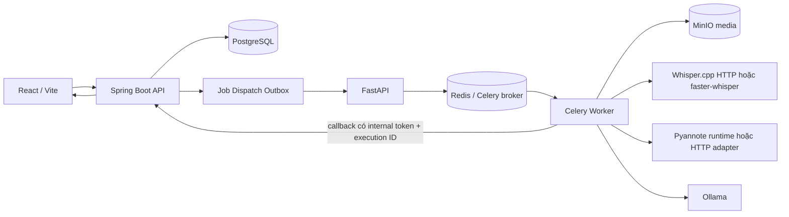

# SmartRec – AI Meeting Assistant

SmartRec là ứng dụng hỗ trợ quản lý cuộc họp và xử lý bản ghi âm/ghi hình. Người dùng tải media lên, gắn với cuộc họp, theo dõi tiến trình xử lý và xem transcript, người nói, nội dung OCR và phân tích cuộc họp trong giao diện web.

Repository hiện có frontend React, backend Spring Boot và AI Engine Python. Luồng AI được tích hợp qua job có trạng thái, hàng đợi Redis/Celery và callback xác thực. Tích hợp luồng end-to-end đang được phát triển/kiểm tra trên working tree hiện tại; không đồng nghĩa chất lượng nhận dạng đã được nghiệm thu.

## Chức năng

| Nhóm | Trạng thái theo mã nguồn hiện tại |
|---|---|
| Đăng nhập, quản lý file/cuộc họp, upload thường và upload phân mảnh | Đã có giao diện và API Spring Boot; cần kiểm thử theo môi trường triển khai cụ thể. |
| Job, theo dõi stage, heartbeat, execution lease, outbox, retry/pause/resume/cancel | Đã có triển khai trong backend; kết quả vận hành phụ thuộc cấu hình và dịch vụ sẵn sàng. |
| Chuẩn hóa media bằng FFmpeg, khử nhiễu WebRTC ANS/AEC, diarization Pyannote | Có trong worker. Chất lượng và khả năng chạy phụ thuộc model, Hugging Face access và tài nguyên. |
| Speech-to-Text và căn chỉnh nhãn người nói | Adapter whisper.cpp HTTP và faster-whisper CPU; chất lượng tiếng Việt cần đánh giá. |
| Keyframe/OCR cho MP4/MKV | Đã tích hợp lấy mẫu bằng FFmpeg và OCR Tesseract `vie+eng`; chất lượng OCR chưa nghiệm thu. |
| Context, summary, decisions, action items | Có bước Ollama và lưu kết quả có cấu trúc; độ đầy đủ/chính xác cần đánh giá thêm. |
| ChromaDB/vector search | Có cấu hình client nhưng không nằm trong luồng worker đang hoạt động; Compose đặt trong profile `vector`. |

## Kiến trúc



Spring Boot quản lý danh tính, metadata cuộc họp, job và dữ liệu kết quả. Outbox lưu yêu cầu dispatch trước khi dispatcher gửi sang FastAPI; FastAPI enqueue task Celery qua Redis. Worker tải media từ MinIO, xử lý theo pipeline và gửi stage/result về callback backend. PostgreSQL là nơi lưu trạng thái job, speaker segments và `meeting_ai_results.results_json`. Frontend đọc các API Spring Boot. Redis đảm nhiệm broker/result backend và một số chức năng upload; MinIO lưu object media.

## Pipeline AI

Worker thực thi tuần tự: (1) tải media từ MinIO; (2) `FFMPEG` trích audio và chuẩn hóa WAV mono 16 kHz; (3) `WEBRTC` chạy chuỗi AEC/ANS và kiểm tra chất lượng; (4) `PYANNOTE` diarization, có chia chunk cho audio dài trên ngưỡng 900 giây; (5) trong stage backend `OUTPUT`, tạo transcript bằng adapter Whisper rồi căn chỉnh speaker theo timeline; (6) với MP4/MKV lấy keyframe định kỳ và OCR; lỗi OCR được ghi nhận nhưng vẫn tiếp tục transcript; (7) ghép transcript và OCR thành context chunks; (8) Ollama tạo summary/decisions/tasks; (9) callback `OUTPUT` gửi speaker segments và các artifact tới backend để lưu.

Trong mô hình stage của backend, STT, OCR, context và LLM đều nằm trong `OUTPUT`, không phải các stage độc lập. Job `COMPLETED` xác nhận luồng xử lý/backend callback hoàn tất, không xác nhận nội dung đạt chuẩn chất lượng.

## Công nghệ

| Lớp | Công nghệ có trong repository |
|---|---|
| Frontend | React 18, Vite 5, React Router, Ant Design, Axios, Zustand, Video.js |
| Backend | Java 17, Spring Boot 3.1.5, Spring Data JPA, Spring Security, JWT, Springdoc OpenAPI |
| AI Engine | Python 3.11, FastAPI, Celery, Pydantic Settings, Requests |
| Media/AI | FFmpeg, WebRTC ANS/AEC; PyTorch 2.2.2 CPU, pyannote.audio 3.1.1, faster-whisper 1.1.1; whisper.cpp qua HTTP; Tesseract OCR tiếng Việt/Anh; Ollama (mặc định `qwen2.5:1.5b`) |
| Lưu trữ/hàng đợi | PostgreSQL 15 Alpine, Redis 7 Alpine, MinIO, Docker Compose |

Phiên bản một số image dịch vụ (ví dụ MinIO `latest` và ChromaDB `latest`) không được pin trong Compose. whisper.cpp và Ollama chạy ngoài Compose trong cấu hình Local + Docker được mô tả ở [Runbook AI Local + Docker](docs/AI_LOCAL_DOCKER_E2E_GUIDE.md).

## Cấu trúc repository

```text
.
├── Frontend/smartrec-frontend/   # React/Vite UI
├── ai-engine/                    # FastAPI, Celery worker, pipeline và tests
├── src/main/java/                # Spring Boot controllers/services/entities
├── src/main/resources/           # application.yml, schema.sql
├── src/test/                     # Backend tests
├── migrations/                   # SQL migrations có trong repository
├── docs/                         # Hướng dẫn kỹ thuật
├── docker-compose.yml            # PostgreSQL, Redis, MinIO, AI Engine/Worker
├── docker-compose.gpu.yml        # Cấu hình GPU riêng
└── pom.xml                       # Maven project
```

## Cài đặt nhanh

Yêu cầu đã xác định từ cấu hình: Java 17, Python 3.11 cho image AI, Node.js/npm tương thích Vite 5, Docker Engine/Desktop và Docker Compose. Cần chuẩn bị Hugging Face token có quyền truy cập model Pyannote gated. whisper.cpp và Ollama cần được cài riêng nếu dùng cấu hình native.

1. Sao chép `.env.example` thành `.env`, thay `SMARTREC_INTERNAL_TOKEN` bằng giá trị ngẫu nhiên riêng và cấu hình Hugging Face token nếu dùng Pyannote local. Không commit `.env` hoặc secret.
2. Khởi chạy các dịch vụ hạ tầng và AI containers cần thiết:

   ```bash
   docker compose up -d postgres redis minio minio-init ai-engine ai-worker
   ```

3. Chạy backend bằng `./mvnw spring-boot:run` từ thư mục gốc, frontend bằng `npm install && npm run dev` từ `Frontend/smartrec-frontend`.
4. Cấu hình và kiểm tra native AI services trước khi chạy media. Cổng whisper.cpp hiện được Compose đặt mặc định là `8081`; Pyannote HTTP adapter mặc định tham chiếu `8086`; Ollama `11434`.

Chi tiết biến môi trường, kiểm tra sẵn sàng, luồng MP3/MP4, SQL đọc dữ liệu và retry xem [docs/AI_LOCAL_DOCKER_E2E_GUIDE.md](docs/AI_LOCAL_DOCKER_E2E_GUIDE.md). Mặc định ứng dụng truy cập tại frontend `http://localhost:5173`, backend `http://localhost:8082/api/v1`, AI Engine `http://localhost:8000`, MinIO `http://localhost:9000` (console `9001`), PostgreSQL `5432`, Redis `6379`.

## Trạng thái phát triển

| Trạng thái | Phạm vi |
|---|---|
| **Completed – đã hoàn thành** | AI Pipeline End-to-End Integration đã được kiểm thử thành công theo đợt kiểm thử được báo cáo; mã nguồn hiện có job/outbox/callback, worker pipeline và lưu artifact. Upload/quản lý cuộc họp, stage monitoring/retry và các màn hình kết quả cũng đã được triển khai. |
| **In Progress – đang hoàn thiện** | AI Quality Improvement: ổn định và đánh giá speaker diarization, STT tiếng Việt, OCR video, summary và action items; kiểm thử lặp lại trên nhiều media. |
| **Pending – chưa triển khai hoặc chưa nghiệm thu** | Bộ benchmark/tiêu chí chất lượng chuẩn chưa có trong repository; native Pyannote HTTP server không nằm trong repository và cần xác minh/cung cấp riêng nếu chọn backend HTTP. |

**AI Pipeline End-to-End Integration đã được kiểm thử thành công, nhưng AI Quality Improvement và một số tính năng nghiệp vụ AI vẫn chưa đạt nghiệm thu.** Repository có source và test liên quan, nhưng không chứa đầy đủ biên bản/metric để tái xác nhận chất lượng. Job hoàn tất không đồng nghĩa chất lượng nội dung hoàn tất.

## Tài liệu và kiểm thử

- [Runbook AI Local + Docker E2E](docs/AI_LOCAL_DOCKER_E2E_GUIDE.md)
- [Frontend README](Frontend/smartrec-frontend/README.md)
- [Luồng đăng nhập frontend](Frontend/smartrec-frontend/LOGIN_FLOW.md)

Repository có test Python trong `ai-engine/tests` và test Java trong `src/test`; danh sách này không khẳng định mọi test hoặc E2E đã chạy trên máy hiện tại. Thông tin chưa được định nghĩa trong source/config được đánh dấu cần xác minh trong runbook.
