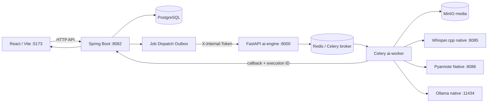

# SmartRec — Hướng dẫn chạy AI Local + Docker và kiểm thử E2E

> Runbook cho cấu hình repository hiện tại trên macOS Apple Silicon. Các bước này chuẩn bị dịch vụ và hướng dẫn kiểm thử thủ công; không chạy E2E, không sửa dữ liệu PostgreSQL bằng tay và không khẳng định chất lượng AI đã được nghiệm thu.

## Mục lục

1. [Giới thiệu](#1-giới-thiệu)
2. [Kiến trúc hệ thống](#2-kiến-trúc-hệ-thống)
3. [Điều kiện tiên quyết](#3-điều-kiện-tiên-quyết)
4. [Cấu hình môi trường và token](#4-cấu-hình-môi-trường-và-token)
5. [Khởi động hạ tầng Docker](#5-khởi-động-hạ-tầng-docker)
6. [Khởi động Spring Boot](#6-khởi-động-spring-boot)
7. [Khởi động Whisper.cpp](#7-khởi-động-whispercpp)
8. [Khởi động Pyannote Native](#8-khởi-động-pyannote-native)
9. [Khởi động Ollama](#9-khởi-động-ollama)
10. [Khởi động React Frontend](#10-khởi-động-react-frontend)
11. [Thứ tự khởi động dịch vụ](#11-thứ-tự-khởi-động-dịch-vụ)
12. [E2E với MP3](#12-e2e-với-mp3)
13. [E2E với MP4](#13-e2e-với-mp4)
14. [Xác minh PostgreSQL](#14-xác-minh-postgresql)
15. [Logs và xử lý sự cố](#15-logs-và-xử-lý-sự-cố)
16. [Quản lý tài nguyên Mac M2 8GB](#16-quản-lý-tài-nguyên-mac-m2-8gb)
17. [Dừng và khởi động lại](#17-dừng-và-khởi-động-lại)
18. [Giới hạn và tiêu chí nghiệm thu](#18-giới-hạn-và-tiêu-chí-nghiệm-thu)

## 1. Giới thiệu

SmartRec là ứng dụng quản lý cuộc họp, tải media, tạo transcript, phân đoạn người nói, OCR slide và tổng hợp nội dung. Runbook này ghi lại cách chạy stack phát triển Local + Docker từ đầu và cách theo dõi một job MP3/MP4 từ giao diện đến kết quả PostgreSQL.

Các thành phần không cùng chạy trong Docker:

| Thành phần | Cách chạy | Cổng / địa chỉ mặc định |
|---|---|---|
| Spring Boot API, Job và Outbox Dispatcher | Native macOS | `8082`, context `/api/v1` |
| Whisper.cpp HTTP server | Native macOS | Pipeline phiên này dùng `8085`; Compose/repo mặc định `8081` |
| Pyannote Native | Native macOS, source ngoài repo | `8086` |
| Ollama | Native macOS | `11434` |
| React/Vite | Native macOS | `5173` |
| PostgreSQL, Redis, MinIO | Docker Compose | `5432`, `6379`, `9000` API và `9001` console |
| FastAPI `ai-engine`, Celery `ai-worker` | Docker Compose | Engine `8000`; worker không publish port |

Luồng E2E mục tiêu là Upload → Spring Boot/DB → Outbox → FastAPI enqueue → Redis/Celery → Worker → native AI services → callback Spring Boot → PostgreSQL → Frontend. E2E tích hợp không tự chứng minh độ chính xác của kết quả AI.

## 2. Kiến trúc hệ thống



Spring Boot tạo job và các stage `FFMPEG`, `WEBRTC`, `PYANNOTE`, `OUTPUT`, rồi Outbox Dispatcher gọi `ai-engine` để enqueue. Worker lấy media từ MinIO, xử lý pipeline và gửi heartbeat/callback có `X-Internal-Token` cùng `X-Execution-Id`. Transcript, OCR, context và `meetingAnalysis` được gửi trong kết quả `OUTPUT`; không phải tất cả đều là stage độc lập.

Trong Docker, `localhost` và `127.0.0.1` trỏ về chính container. Worker dùng tên dịch vụ Compose (`redis`, `minio`) cho các dịch vụ trong Compose và `host.docker.internal` để gọi các tiến trình chạy trên Mac. Ví dụ `WHISPER_CPP_URL=http://host.docker.internal:8085/inference`. Ở tiến trình native trên Mac, dùng `localhost` đến cổng đã publish, ví dụ Spring Boot gọi Engine tại `http://localhost:8000`.

Whisper và Pyannote cần bind interface mà Docker Desktop truy cập được. Hướng dẫn mặc định dưới đây dùng `127.0.0.1` theo cấu hình dịch vụ native; nếu container không thể truy cập, thử bind `0.0.0.0` hoặc interface LAN phù hợp, giữ macOS firewall và chỉ mở trong mạng tin cậy. Luôn kiểm tra TCP từ chính `ai-worker`; `curl` trên Mac không chứng minh container truy cập được.

## 3. Điều kiện tiên quyết

Chạy kiểm tra từ thư mục gốc repository. Các lệnh chỉ in phiên bản/đường dẫn, không cài lại phần mềm.

```bash
pwd
java -version
./mvnw -version
docker version
docker compose version
python3 --version
node --version
npm --version
ffmpeg -version
command -v whisper-server
whisper-server --help
ollama --version
```

Repository yêu cầu Java 17 và Maven Wrapper. Frontend nằm ở `Frontend/smartrec-frontend`, dùng React 18/Vite 5; README khuyến nghị Node.js 18 trở lên. Dockerfile AI dùng Python 3.11, PyTorch/torchaudio 2.2.2 CPU, pyannote.audio 3.1.1 và faster-whisper 1.1.1; Docker image cài FFmpeg và Tesseract `vie+eng`. Những phiên bản native Python của Pyannote (Python 3.12, PyTorch 2.7.1, pyannote.audio 3.1.1) thuộc môi trường ngoài repository.

Kiểm tra model và virtualenv đã được cung cấp cho môi trường này:

```bash
test -f models/whisper/ggml-large-v3-turbo-q5_0.bin && echo 'Whisper model: FOUND' || echo 'Whisper model: MISSING'
test -f "$HOME/smartrec-pyannote-native/server.py" && echo 'Pyannote server: FOUND' || echo 'Pyannote server: MISSING'
test -x "$HOME/.venvs/smartrec-pyannote/bin/python" && "$HOME/.venvs/smartrec-pyannote/bin/python" --version
```

Model Whisper phiên E2E là `models/whisper/ggml-large-v3-turbo-q5_0.bin`, chạy tiếng Việt. Whisper.cpp binary cần hỗ trợ giao thức endpoint `/inference` mà adapter hiện tại dùng. Model Pyannote `pyannote/speaker-diarization-3.1` là gated: Hugging Face account/token phải được chấp thuận điều khoản model. Ollama dùng `qwen2.5:1.5b`; không tự tải model khác. Không có benchmark trong runbook để kết luận Large V3 Turbo chính xác hơn model khác.

Nếu `.env` chưa có, tạo từ mẫu rồi điền secret cục bộ bằng trình soạn thảo an toàn; không in file ra terminal:

```bash
cp .env.example .env
```

Không thay hoặc chia sẻ token hiện có. `.env` là cấu hình local, không commit.

## 4. Cấu hình môi trường và token

Docker Compose đọc `.env` ở thư mục Compose để nội suy `${VAR}` và truyền những biến được khai báo cho container. Điều này **không** nạp `.env` vào tiến trình `./mvnw spring-boot:run` hoặc Python native trên macOS. Maven Wrapper không tự đọc `.env`; Pyannote Native cũng không tự đọc file đó.

### Biến quan trọng

| Biến | Vai trò |
|---|---|
| `SMARTREC_INTERNAL_TOKEN` | Secret HTTP nội bộ dùng chung giữa Spring Boot, ai-engine và ai-worker; header `X-Internal-Token` cho enqueue, heartbeat, job lookup và callback. Không phải Hugging Face token. |
| `HF_TOKEN` | Hugging Face access token để tải/chạy model gated trong Pyannote. Khi chọn `DIARIZATION_BACKEND=local`, Compose cũng chuyển biến này cho worker. Native Pyannote đọc biến này khi nạp model. |
| `PYANNOTE_NATIVE_TOKEN` | Token riêng bảo vệ HTTP Native Pyannote; adapter gửi `X-SmartRec-Token`. Không thay thế `HF_TOKEN`. |
| `DIARIZATION_BACKEND` | `local` (mặc định, inference Pyannote trong Worker container) hoặc `http` (gọi native endpoint ngoài repo). |
| `PYANNOTE_NATIVE_URL` | URL gốc HTTP Pyannote; mặc định `http://host.docker.internal:8086`. |
| `STT_PROVIDER` | Mặc định `whisper_cpp`; các lựa chọn khác trong code là `faster_whisper_cpu` và `faster_whisper`. |
| `WHISPER_CPP_URL` | URL Worker gọi; repo/Compose mặc định `http://host.docker.internal:8081/inference`. Với server phiên này ở 8085, đặt `http://host.docker.internal:8085/inference`. |
| `OLLAMA_BASE_URL` | Worker gọi Ollama, mặc định `http://host.docker.internal:11434`. |
| `BACKEND_BASE_URL` | Worker gọi Spring Boot, mặc định `http://host.docker.internal:8082/api/v1`. |

Các biến cấu hình native quan trọng khác cần cùng giá trị với Compose: `SPRING_DATASOURCE_URL/USERNAME/PASSWORD`, `REDIS_HOST/PORT`, `MINIO_ENDPOINT`, `MINIO_PUBLIC_ENDPOINT`, `MINIO_ACCESS_KEY`, `MINIO_SECRET_KEY`, `AI_ENGINE_BASE_URL`, `CORS_ALLOWED_ORIGINS`. Giá trị mặc định trong `application.yml` phù hợp với Compose mặc định: DB `smartrec_db`, user `postgres`, MinIO tại localhost:9000, Redis localhost:6379. Nếu `.env` đang dùng credentials khác, export các biến Spring tương ứng trước khi chạy backend. Không giả định token là cấu hình duy nhất cần đồng bộ.

### Phương án A — không cần cài thêm công cụ

Các ví dụ dùng `docker compose config --format json` để Compose tự phân tích `.env`; Python chỉ trích đúng biến cần thiết và không in cấu hình/token ra terminal. Chạy từ root repo, không bật `set -x`. Mỗi lệnh khởi động chạy trong Terminal riêng và giữ Terminal mở.

**Spring Boot với token lấy từ `.env`:**

```bash
SMARTREC_INTERNAL_TOKEN="$(docker compose config --format json | python3 -c 'import json,sys; print(json.load(sys.stdin)["services"]["ai-engine"]["environment"]["SMARTREC_INTERNAL_TOKEN"])')" ./mvnw spring-boot:run
```

Lệnh này chuyển token vào environment của tiến trình Maven/Spring Boot mà không in giá trị. Nó chỉ cấu hình biến trong lệnh đó; nếu Spring cần DB/Redis/MinIO credentials khác mặc định trong `application.yml`, export chúng trong cùng Terminal trước khi chạy Maven.

Xác minh biến trong Terminal mà không lộ giá trị:

```bash
if [ -n "$(docker compose config --format json | python3 -c 'import json,sys; print(json.load(sys.stdin)["services"]["ai-engine"]["environment"].get("SMARTREC_INTERNAL_TOKEN", ""))')" ]; then echo 'SMARTREC_INTERNAL_TOKEN: CONFIGURED'; else echo 'SMARTREC_INTERNAL_TOKEN: MISSING'; fi
```

**Pyannote Native lấy `HF_TOKEN` từ `.env`:**

```bash
SMARTREC_ROOT="$(pwd -P)" # chạy dòng này khi Terminal đang ở root SmartRec
cd "$HOME/smartrec-pyannote-native"
HF_TOKEN="$(cd "$SMARTREC_ROOT" && docker compose config --format json | python3 -c 'import json,sys; print(json.load(sys.stdin)["services"]["ai-worker"]["environment"].get("HF_TOKEN", ""))')" \
  "$HOME/.venvs/smartrec-pyannote/bin/python" -m uvicorn server:app --host 127.0.0.1 --port 8086
```

Chạy `SMARTREC_ROOT="$(pwd -P)"` khi Terminal đang ở root repo; biến này giữ đường dẫn khi chuyển sang thư mục native. Ở máy hiện tại, các đường dẫn đã xác minh là `$HOME/smartrec-pyannote-native/server.py` và `$HOME/.venvs/smartrec-pyannote/bin/python`. Nếu checkout/native env khác vị trí, sửa path theo thực tế. Lệnh export `HF_TOKEN` trong environment cho Uvicorn mà không in token.

**Cách lấy `PYANNOTE_NATIVE_TOKEN`:** khi `DIARIZATION_BACKEND=http`, token cần khớp cấu hình `auth.py` của Native Pyannote và giá trị `PYANNOTE_NATIVE_TOKEN` trong `.env` cho Worker. Compose cần được recreate sau khi thay `.env`. Đừng dùng HF token hoặc internal token làm token này nếu cấu hình native không quy định như vậy.

### Phương án B — tự nạp theo thư mục với direnv (tùy chọn)

direnv tự chạy `.envrc` khi shell đi vào thư mục đã được cho phép; mỗi Terminal/shell mới cần hook hoạt động. Không export tất cả `.env`, vì file còn có credentials không cần cho từng tiến trình. Có thể để `.envrc` chỉ chứa tên biến và cách lấy giá trị, không chứa secret:

1. Cài direnv bằng Homebrew nếu chưa có: `brew install direnv`.
2. Zsh: thêm `eval "$(direnv hook zsh)"` vào `~/.zshrc`, sau đó mở Terminal mới. Bash: thêm `eval "$(direnv hook bash)"` vào `~/.bashrc` (macOS login Bash có thể cần `~/.bash_profile` để source `.bashrc`).
3. Tại root repo, tạo `.envrc` với nội dung tối thiểu:

   ```bash
   export SMARTREC_INTERNAL_TOKEN="$(docker compose config --format json | python3 -c 'import json,sys; print(json.load(sys.stdin)["services"]["ai-engine"]["environment"]["SMARTREC_INTERNAL_TOKEN"])')"
   export HF_TOKEN="$(docker compose config --format json | python3 -c 'import json,sys; print(json.load(sys.stdin)["services"]["ai-worker"]["environment"].get("HF_TOKEN", ""))')"
   ```

4. Chạy `direnv allow` tại root. Mỗi shell đã cài hook sẽ nạp hai biến khi vào thư mục; shell/terminal không có hook sẽ không nạp.
5. Xác minh chỉ trạng thái, không echo biến:

   ```bash
   [ -n "${SMARTREC_INTERNAL_TOKEN:-}" ] && echo 'SMARTREC_INTERNAL_TOKEN: CONFIGURED' || echo 'SMARTREC_INTERNAL_TOKEN: MISSING'
   [ -n "${HF_TOKEN:-}" ] && echo 'HF_TOKEN: CONFIGURED' || echo 'HF_TOKEN: MISSING'
   ```

6. Từ root repo, khởi động Spring Boot bằng `./mvnw spring-boot:run`. Lệnh Pyannote có thể mở từ cùng shell sau khi `cd "$HOME/smartrec-pyannote-native"`; environment đã được nạp trong shell đó.

`.envrc` ví dụ không chứa giá trị secret, nhưng nên loại khỏi thay đổi Git của máy cá nhân nếu không muốn chia sẻ cấu hình shell: thêm tên `.envrc` vào `.git/info/exclude` (chỉ local) và kiểm tra `git status --short`. `direnv allow` cấp quyền thực thi nội dung `.envrc`; xem nội dung trước khi allow. Không dùng `source .env`, `set -x`, `env`, `printenv`, hoặc `cat .env` để kiểm tra token.

## 5. Khởi động hạ tầng Docker

Tại root repository, đảm bảo Docker Desktop đang chạy, `.env` đã cấu hình và token internal khác placeholder. Khởi động các service trong Compose phục vụ luồng mặc định:

```bash
docker compose up -d postgres redis minio minio-init ai-engine ai-worker
docker compose ps
```

Các service thật trong Compose là `postgres`, `redis`, `minio`, `minio-init`, `chromadb` (profile `vector`), `ai-engine`, `ai-worker`. Không có Whisper, Pyannote, Ollama, Spring Boot hoặc Frontend trong Compose. `minio-init` tạo bucket/CORS rồi có thể kết thúc với exit code 0.

Kiểm tra hạ tầng và Engine:

```bash
docker compose ps
docker compose logs --tail=100 ai-engine ai-worker
docker compose exec redis redis-cli ping
curl -fsS http://127.0.0.1:8000/health
```

Mong đợi Redis `PONG`, Engine JSON `{"status":"HEALTHY",...}`. Compose hiện không khai báo healthcheck container, nên `Up` chỉ xác nhận process container còn chạy; xem logs và readiness Celery. Worker không có HTTP health endpoint/port publish. Logs Worker phải cho thấy khởi tạo Celery và kết nối Redis; xem trạng thái node bằng:

```bash
docker compose exec ai-worker celery -A app.celery_app.celery_app inspect ping
```

Kết quả `pong` xác nhận worker trả lời Celery inspect. Nếu inspect không khả dụng, đối chiếu logs worker, Redis `PONG` và xử lý job thử ở bước E2E.

Phân biệt các thao tác Docker:

- `docker compose up -d`: tạo/cập nhật và chạy service đã chỉ định. Dùng khi khởi động stack.
- `docker compose up -d --no-deps SERVICE`: chạy/cập nhật service nhưng không khởi động dependencies. Chỉ dùng khi dependencies đã sẵn sàng.
- `docker compose build ai-worker`: build image mới từ `ai-engine/`; không tự thay code của container đang chạy.
- `docker compose up -d --no-deps --force-recreate ai-worker`: tạo container mới từ image/config hiện tại, cần sau khi build hoặc muốn nhận environment mới.

Thường chỉ restart/recreate khi thay env/config; rebuild khi thay source hoặc Dockerfile/dependencies. Sau sửa code `ai-engine`, build service cần cập nhật, rồi force-recreate container tương ứng. Nếu chỉ đổi `.env`, Compose thường cần recreate service để nhận env mới; không cần build image.

```bash
docker compose build ai-worker
docker compose up -d --no-deps --force-recreate ai-worker
```

`ai-engine` cũng dùng cùng image build context; nếu sửa code FastAPI, chạy `docker compose build ai-engine` rồi `docker compose up -d --no-deps --force-recreate ai-engine`.

## 6. Khởi động Spring Boot

Spring Boot chạy native trên Mac ở `8082` và kết nối Docker published ports tại localhost. Trước khi chạy, bảo đảm PostgreSQL, Redis, MinIO và AI Engine đã sẵn sàng. Dùng Phương án A ở mục 4 để truyền `SMARTREC_INTERNAL_TOKEN` từ Compose `.env` mà không in nó. Mặc định datasource là `jdbc:postgresql://localhost:5432/smartrec_db`, Redis `localhost:6379`, MinIO `localhost:9000`; đồng bộ `SPRING_DATASOURCE_*`, `REDIS_*`, `MINIO_*`, `AI_ENGINE_BASE_URL` nếu `.env` đã đổi credentials/địa chỉ.

Tại root repo, Terminal riêng, giữ Terminal mở:

```bash
SMARTREC_INTERNAL_TOKEN="$(docker compose config --format json | python3 -c 'import json,sys; print(json.load(sys.stdin)["services"]["ai-engine"]["environment"]["SMARTREC_INTERNAL_TOKEN"])')" ./mvnw spring-boot:run
```

`application.yml` dùng `ddl-auto: update` và `sql.init.mode: always`; khởi động có thể thay đổi schema/chạy `schema.sql`. Không dùng runbook để sửa DB thủ công. Khi mở DB có dữ liệu cần giữ, sao lưu theo quy trình dự án trước khi chạy backend.

Kiểm tra HTTP mà không gửi secret:

```bash
curl -sS -o /dev/null -w 'HTTP %{http_code}\n' http://127.0.0.1:8082/api/v1/meetings
```

Endpoint có auth nên `401` cũng có thể xác nhận server HTTP phản hồi. Không có Spring Actuator health endpoint được khai báo trong repo; đừng xem `404` của route không tồn tại là health check. Xem startup logs để xác nhận kết nối datasource. Springdoc UI phụ thuộc security/config; nếu cần tra API, xem route `/v3/api-docs` hoặc `/swagger-ui/index.html` theo ứng dụng đang chạy.

## 7. Khởi động Whisper.cpp

Whisper.cpp chạy native trên macOS. Phiên E2E dùng model Large V3 Turbo Q5_0 và server port 8085 theo cấu hình môi trường. Adapter Worker gửi WAV multipart field `file` tới `/inference`, kèm `language=vi`, `response_format=verbose_json`, `temperature=0`.

Từ **thư mục gốc SmartRec**, Terminal riêng:

```bash
whisper-server \
  -m "$(pwd)/models/whisper/ggml-large-v3-turbo-q5_0.bin" \
  --host 127.0.0.1 \
  --port 8085 \
  -l vi \
  -t 4
```

Giữ Terminal mở; chờ log báo server đã bind và model đã được nạp. Nếu model đang được nạp lazily, request đầu tiên mới có thể hoàn tất việc load. Whisper process nghe trên Mac; Worker trong Docker phải dùng `host.docker.internal`, không dùng `127.0.0.1`.

Compose/repo hiện đặt `WHISPER_CPP_URL=http://host.docker.internal:8081/inference`; cần đặt `.env` thành `WHISPER_CPP_URL=http://host.docker.internal:8085/inference` cho phiên port 8085 **trước khi tạo lại** ai-engine và ai-worker. Không in `.env` để xác nhận; kiểm tra cấu hình hiệu lực qua lệnh Python chỉ in URL (URL này không có secret):

```bash
docker compose exec ai-worker python -c 'import os; print(os.getenv("WHISPER_CPP_URL", "<missing>"))'
```

Kiểm tra kết nối TCP từ Worker:

```bash
docker compose exec ai-worker python -c 'import socket; s=socket.create_connection(("host.docker.internal", 8085), timeout=5); print("Whisper TCP: CONNECTED"); s.close()'
```

TCP chỉ chứng minh cổng mở; kiểm tra inference thực tế qua job E2E với audio. Nếu connection refused, kiểm tra model/path, logs server, `WHISPER_CPP_URL`, binding và firewall. Nếu listener `127.0.0.1` không nhận kết nối từ Docker Desktop, thử `--host 0.0.0.0`, rồi lặp lại kiểm tra trong Worker. Không suy ra chất lượng model chỉ từ server khởi động thành công.

## 8. Khởi động Pyannote Native

Pyannote Native nằm ngoài repo tại `$HOME/smartrec-pyannote-native/`. Môi trường đã xác minh cho máy này: `$HOME/.venvs/smartrec-pyannote/bin/python`; server dùng Python 3.12, PyTorch 2.7.1, pyannote.audio 3.1.1. Source hiện dùng model `pyannote/speaker-diarization-3.1`, MPS cho diarization và CPU cho speaker embeddings. Native server source đọc `HF_TOKEN` khi load model; service auth riêng kiểm tra `PYANNOTE_NATIVE_TOKEN` trong header `X-SmartRec-Token`.

Ở **Terminal Pyannote**, trước khi chuyển thư mục, đặt biến `SMARTREC_ROOT` khi đang ở root repo. Sau đó chạy:

```bash
SMARTREC_ROOT="$(pwd -P)" # Terminal lúc này phải ở root SmartRec
cd "$HOME/smartrec-pyannote-native"
HF_TOKEN="$(cd "$SMARTREC_ROOT" && docker compose config --format json | python3 -c 'import json,sys; print(json.load(sys.stdin)["services"]["ai-worker"]["environment"].get("HF_TOKEN", ""))')" \
  "$HOME/.venvs/smartrec-pyannote/bin/python" \
  -m uvicorn server:app --host 127.0.0.1 --port 8086
```

Lệnh không yêu cầu gõ token mỗi lần, không in token, và không đưa token vào Markdown. Nếu `.env` có HF token rỗng, server có thể lên nhưng inference sẽ báo `HF_TOKEN missing`. Xác minh trạng thái trong shell mà không lộ giá trị:

```bash
if [ -n "$(cd "$SMARTREC_ROOT" && docker compose config --format json | python3 -c 'import json,sys; print(json.load(sys.stdin)["services"]["ai-worker"]["environment"].get("HF_TOKEN", ""))')" ]; then echo 'HF_TOKEN: CONFIGURED'; else echo 'HF_TOKEN: MISSING'; fi
```

`/health` trả trạng thái process, **không** chứng minh token/model/inference đã hoạt động. `/auth-check` cần `X-SmartRec-Token`; kiểm tra auth từ Docker worker mà không in token bằng:

```bash
docker compose exec ai-worker python -c 'import os,requests; r=requests.get(os.getenv("PYANNOTE_NATIVE_URL", "http://host.docker.internal:8086").rstrip("/")+"/auth-check", headers={"X-SmartRec-Token":os.getenv("PYANNOTE_NATIVE_TOKEN", "")}, timeout=10); print("Pyannote auth:", r.status_code)'
```

Để kiểm tra `/diarize` và `/embeddings`, chạy job E2E; adapter gửi audio WAV thật bằng các endpoint này. Có thể kiểm tra thủ công với file WAV PCM và token qua Python `requests` từ container, nhưng không đưa token vào URL/CLI output. `/diarize` cần multipart `audio`; `/embeddings` cần multipart `audio` và `speaker_segments` JSON. Contract response là `status: SUCCESS`, danh sách segments và embedding vectors 256 chiều. `/embeddings` yêu cầu WAV 16 kHz PCM16. HTTP 200 `/health` hoặc `/auth-check` không thay thế inference thành công.

Nếu muốn Worker sử dụng Native Pyannote, đặt trong `.env`: `DIARIZATION_BACKEND=http`, `PYANNOTE_NATIVE_URL=http://host.docker.internal:8086`, và `PYANNOTE_NATIVE_TOKEN` khớp cấu hình auth service. Recreate `ai-worker` sau khi sửa env. Nếu giữ `DIARIZATION_BACKEND=local` (mặc định), Worker chạy Pyannote bên trong Docker và cần `HF_TOKEN` trong container; native server vẫn có thể chạy nhưng không được Worker gọi.

## 9. Khởi động Ollama

Ollama chạy native trên Mac. Trong Terminal riêng:

```bash
ollama serve
```

Giữ Terminal mở. Kiểm tra model và server trong Terminal khác:

```bash
ollama list
ollama show qwen2.5:1.5b
curl -fsS http://127.0.0.1:11434/api/chat \
  -H 'Content-Type: application/json' \
  -d '{"model":"qwen2.5:1.5b","stream":false,"messages":[{"role":"user","content":"Trả lời ngắn: xin chào"}]}'
```

Không tự tải model nếu `qwen2.5:1.5b` chưa có; chuẩn bị model theo quy trình môi trường. Kết quả chat JSON có `message.content` xác nhận inference trên Mac. Worker dùng `OLLAMA_BASE_URL=http://host.docker.internal:11434`; kiểm tra kết nối từ Docker:

```bash
docker compose exec ai-worker python -c 'import socket; s=socket.create_connection(("host.docker.internal", 11434), timeout=5); print("Ollama TCP: CONNECTED"); s.close()'
```

TCP chưa xác nhận Worker gửi được prompt/model; log E2E cần không có timeout/OOM và có `meetingAnalysis` được lưu.

## 10. Khởi động React Frontend

Frontend nằm tại `Frontend/smartrec-frontend`; package script mở Vite tại cổng `5173`. API URL mặc định trong `src/lib/http/client.js` là `http://localhost:8082/api/v1`; có thể override bằng `VITE_API_BASE_URL`. CORS mặc định cho phép localhost/127.0.0.1:5173. Dùng URL localhost nhất quán để tránh khác biệt origin.

Trong Terminal riêng:

```bash
cd Frontend/smartrec-frontend
npm install
npm run dev
```

Chỉ chạy `npm install` khi `node_modules` chưa được cài hoặc dependency cần đồng bộ; lệnh có thể thay đổi lockfile, kiểm tra Git status sau đó. Giữ Terminal mở, mở `http://localhost:5173`. Đăng nhập bằng tài khoản đã được cấu hình cho môi trường này.

## 11. Thứ tự khởi động dịch vụ

Thứ tự phụ thuộc: Docker Desktop trước; Postgres/Redis/MinIO trước Spring Boot/Engine/Worker; native AI endpoints trước khi gửi job. Frontend có thể khởi động bất kỳ lúc nào sau khi backend sẵn sàng.

- [ ] `.env` local đã cấu hình; không in secret.
- [ ] Docker Desktop hoạt động.
- [ ] PostgreSQL sẵn sàng (`docker compose ps`, kết nối psql).
- [ ] Redis sẵn sàng (`redis-cli ping` → `PONG`).
- [ ] MinIO và bucket sẵn sàng (`minio-init` đã hoàn thành).
- [ ] FastAPI AI Engine sẵn sàng (`GET :8000/health`).
- [ ] Celery Worker sẵn sàng (logs và `celery inspect ping`).
- [ ] Whisper Server sẵn sàng, model đã nạp, Worker gọi được URL/port.
- [ ] Pyannote Native sẵn sàng nếu chọn `DIARIZATION_BACKEND=http`; nếu local thì Worker có HF token.
- [ ] Ollama Server và model `qwen2.5:1.5b` sẵn sàng, inference thử được.
- [ ] Spring Boot sẵn sàng, có `SMARTREC_INTERNAL_TOKEN` và kết nối DB/Redis/MinIO.
- [ ] React Frontend sẵn sàng trên `5173`.
- [ ] Token HTTP nội bộ đồng nhất giữa Spring Boot, ai-engine, ai-worker; `PYANNOTE_NATIVE_TOKEN` riêng nếu dùng native HTTP.

Có thể khởi động Spring Boot trước Ollama/Whisper để duyệt giao diện, nhưng không bắt đầu job cho đến khi các phụ thuộc inference sẵn sàng. Nếu dùng Pyannote `local`, không cần Pyannote Native server.

## 12. E2E với MP3

Dùng MP3 ngắn, hợp lệ và có giọng nói rõ. Upload, tạo job và xử lý là thao tác có ghi media/job/result vào môi trường; chọn meeting thử nghiệm phù hợp.

1. Mở Frontend, đăng nhập, tạo/chọn meeting và upload MP3 qua giao diện upload hiện có. Chờ file/meeting hoàn tất lưu MinIO.
2. Mở meeting, chọn thao tác **Process AI**/bắt đầu xử lý trong UI. UI gọi `POST /api/v1/meetings/{id}/process` (Controller thực tế là `POST /meetings/{id}/process` dưới context `/api/v1`). Không tự gọi internal enqueue endpoint.
3. Xác nhận UI hiển thị Job `QUEUED`, sau đó `PROCESSING`; lưu lại meeting ID/job ID để đối chiếu SQL.
4. Theo dõi `docker compose logs -f ai-engine ai-worker` và Terminal Spring Boot. Mong đợi Engine nhận enqueue, Worker nhận task, tải media từ MinIO và callback heartbeat.
5. Theo dõi stage `FFMPEG` (trích/chuẩn hóa WAV 16 kHz mono), `WEBRTC` (AEC/ANS), `PYANNOTE` (speaker turns), `OUTPUT` (STT, căn chỉnh speaker, context/LLM và kết quả). STT/OCR/LLM hiện nằm bên trong `OUTPUT`, không phải stage riêng.
6. Xác nhận callback `OUTPUT` được backend chấp nhận, Job chuyển `COMPLETED`, transcript và speaker segments có dữ liệu phù hợp. Mở tab Transcript/Speakers trong meeting.
7. Mở Summary/Tasks (dữ liệu `meetingAnalysis.summary`, `keyDecisions`, `tasks`) và kiểm tra nội dung. Ollama có thể hợp lệ trả summary/tasks rỗng nếu transcript không hữu ích.
8. Gọi UI tải lại hoặc mở lại meeting để xác minh persistence, sau đó đối chiếu `meeting_ai_results`, `speaker_segments`, `processing_jobs`, `job_stages`, `job_dispatch_outbox` tại mục 14.

Backend cũng có `GET /api/v1/meetings/{id}/ai-results` (yêu cầu đăng nhập) và response bọc payload trong `results`. Các API job yêu cầu auth người dùng; worker callback/heartbeat là API nội bộ xác thực riêng. Không đặt token vào URL.

## 13. E2E với MP4

Thực hiện các bước như MP3 với MP4 có audio và slide rõ nét. Ngoài stage pipeline, kiểm tra:

- FFmpeg đọc video và trích audio để xử lý pipeline.
- OUTPUT gọi video OCR: code lấy một frame mỗi 5 giây, tối đa 80 frame; Tesseract chạy `vie+eng`, timestamps theo mốc frame. Text trùng lặp được loại.
- Tab Slide/OCR trên giao diện có thể hiển thị frame, timestamp và OCR text; đối chiếu với slide gốc.
- Kiểm tra transcript và OCR được ghép thành context cho meeting analysis; đối chiếu timestamp OCR với timestamp transcript.

OCR exception được lưu dạng `FAILED` với frames rỗng, còn không chạy OCR (ví dụ input không phải video) có thể là `SKIPPED`; lỗi OCR không nhất thiết làm pipeline dừng. Không đánh đồng file MP4 xử lý xong với OCR chính xác.

## 14. Xác minh PostgreSQL

Entity hiện tại xác nhận bảng/cột bên dưới. Từ root repo, kết nối bằng credentials theo `.env` (ví dụ mặc định):

```bash
docker compose exec postgres psql -U postgres -d smartrec_db
```

Các truy vấn sau chỉ đọc. Thay UUID placeholder bằng giá trị thật, không gồm dấu `< >`.

```sql
SELECT id, meeting_id, media_file_id, status, current_stage, retry_count,
       error_code, error_message, execution_id, lease_expires_at,
       last_heartbeat_at, created_at, updated_at
FROM processing_jobs
WHERE id = '<JOB_UUID>';

SELECT id, job_id, stage, status, retry_count, error_code, error_message,
       started_at, completed_at, created_at, updated_at
FROM job_stages
WHERE job_id = '<JOB_UUID>'
ORDER BY created_at, stage;

SELECT id, job_id, attempt_count, available_at, dispatched_at, last_error, created_at
FROM job_dispatch_outbox
WHERE job_id = '<JOB_UUID>'
ORDER BY created_at;

SELECT id, meeting_id, speaker_label, start_time, end_time
FROM speaker_segments
WHERE meeting_id = '<MEETING_UUID>'
ORDER BY start_time;

SELECT id, meeting_id, processing_job_id, created_at, updated_at,
       jsonb_typeof(results_json::jsonb) AS json_type,
       results_json::jsonb -> 'transcript' AS transcript,
       results_json::jsonb -> 'ocr' AS ocr,
       results_json::jsonb -> 'meetingAnalysis' AS meeting_analysis,
       results_json::jsonb #>> '{meetingAnalysis,summary}' AS summary,
       results_json::jsonb #> '{meetingAnalysis,keyDecisions}' AS key_decisions,
       results_json::jsonb #> '{meetingAnalysis,tasks}' AS tasks
FROM meeting_ai_results
WHERE meeting_id = '<MEETING_UUID>';

SELECT jsonb_array_length(
         COALESCE(results_json::jsonb #> '{transcript,segments}', '[]'::jsonb)
       ) AS transcript_segment_count
FROM meeting_ai_results
WHERE meeting_id = '<MEETING_UUID>';
```

`meeting_ai_results.results_json` là text chứa JSON với root keys `transcript`, `ocr`, `context`, `meetingAnalysis`; API `/ai-results` bọc JSON này trong trường `results`. `meetingAnalysis` có `summary`, `keyDecisions`, `tasks`. Transcript được lưu trong payload JSON; không giả định có bảng `transcripts`. Outbox fields `attempt_count`, `last_error`, `available_at`, `dispatched_at` giúp xác định dispatch/retry. Chỉ dùng `SELECT` cho bước xác minh thông thường; không cập nhật `dispatched_at` để giả lập enqueue thành công và không chạy UPDATE/DELETE.

## 15. Logs và xử lý sự cố

Xem logs theo service:

```bash
docker compose logs --tail=200 ai-engine ai-worker postgres redis minio
```

Native services ghi log trong Terminal đã khởi động chúng. Trước khi chia sẻ logs, rà soát để tránh gửi token, thông tin người dùng hoặc dữ liệu media.

### A. `SMARTREC_INTERNAL_TOKEN must be configured`

Triệu chứng: job được tạo và ở `QUEUED`, `job_dispatch_outbox.dispatched_at` là `NULL`, `attempt_count` tăng, `last_error` ghi lỗi token; các stage vẫn `PENDING`.

Nguyên nhân: Spring Boot chạy native không nhận biến trong Compose `.env`. Khởi động lại backend bằng Phương án A hoặc shell direnv đã allow. Đảm bảo Compose containers cũng được tạo với cùng token. Không echo token; kiểm tra trạng thái CONFIGURED/MISSING và đối chiếu log lỗi.

### B. `HF_TOKEN missing for native Pyannote`

Pyannote process native chưa có `HF_TOKEN`. Dừng server bằng Ctrl-C, chạy lại với lệnh lấy token từ `.env` ở mục 8. Không nhầm `SMARTREC_INTERNAL_TOKEN` hoặc `PYANNOTE_NATIVE_TOKEN` với HF token. Token cần có quyền truy cập model gated.

### C. Pyannote HTTP 500

HTTP 500 không luôn do token. Xem traceback Terminal Pyannote và kiểm tra HF token/quyền model, tải model, MPS khả dụng, RAM/Unified Memory, WAV đúng format PCM16 và endpoint contract. `/health` chỉ kiểm tra process; `/diarize`/`/embeddings` là inference. Native code hiện trả lỗi chung ra HTTP, chi tiết nằm trong log server.

### D. Whisper Connection Refused / timeout

Xác nhận server đang nghe `8085` và đã load đúng model; kiểm tra TCP từ `ai-worker`, bind host, firewall và `WHISPER_CPP_URL`. Compose mặc định vẫn là port `8081`, cần sửa `.env` sang `8085` và recreate ai-engine/ai-worker. Adapter gọi `/inference`, không phải root endpoint.

### E. Ollama timeout / OOM

Kiểm tra Ollama server và model `qwen2.5:1.5b`, inference trực tiếp, TCP từ Worker, Worker logs, RAM/Swap, context (`OLLAMA_NUM_CTX`, mặc định 3072) và timeout (`OLLAMA_TIMEOUT_SECONDS`, mặc định 900). Giảm concurrency về 1 (mặc định) và không chạy inference nặng song song.

### F. Job `QUEUED`, stages `PENDING`

Theo thứ tự: Spring Boot còn chạy; token có mặt; Outbox Dispatcher hoạt động; xem `last_error`, `available_at`, `attempt_count`; Engine `/health`; Redis `PONG`; Engine enqueue logs; Celery Worker readiness/logs. `dispatched_at IS NULL` nghĩa chưa đánh dấu dispatch. Không tự sửa outbox hoặc gọi internal enqueue thủ công để làm job có vẻ đã chạy.

### G. Job `COMPLETED` nhưng Summary rỗng

Kiểm tra transcript có text dùng được, `meetingAnalysis.status`, phản hồi/log Ollama, JSON parser và giá trị được lưu tại `results_json`, sau đó kiểm tra Frontend mapping. Worker ghi `meetingAnalysis.status = NO_USABLE_TRANSCRIPT` khi không có transcript hữu ích; completion kỹ thuật có thể vẫn hoàn tất nhưng phân tích không có nội dung. Tasks cũng có thể rỗng nếu không phát hiện hành động được giao/cam kết.

### H. Celery callback lỗi

Kiểm tra hai tiến trình có cùng `SMARTREC_INTERNAL_TOKEN`, callback request/schema, Spring Boot endpoint, DB persistence và `X-Execution-Id`/execution lease. Backend callback là `POST /api/v1/jobs/{jobId}/callback`; heartbeat và callback cần internal token cùng execution ID. Xem log cả hai phía; không retry mù nếu job còn active.

### I. Worker code cũ sau khi sửa source

Build image không tự thay container. `docker compose build ai-worker` rồi `docker compose up -d --no-deps --force-recreate ai-worker`. Chỉ rebuild nếu source/Dockerfile/dependency thay đổi; đổi env thì recreate container là đủ.

## 16. Quản lý tài nguyên Mac M2 8GB

Unified Memory được chia sẻ giữa macOS, Docker Desktop, Pyannote/MPS, Whisper và Ollama. Không chạy inference nặng song song trên máy 8GB; Worker concurrency mặc định là `1`. Whisper Large V3 Turbo dùng nhiều bộ nhớ/tài nguyên hơn Small; Pyannote và Ollama có thể cùng chiếm memory đáng kể. MPS không được đảm bảo luôn nhanh hoặc ổn định hơn CPU.

Theo dõi Activity Monitor (Memory Pressure/Swap Used) hoặc:

```bash
memory_pressure
vm_stat
docker stats
```

Giữ cuộc họp thử ngắn, chạy tuần tự, chờ model load và inference hoàn tất rồi mới thử service nặng tiếp theo. Nếu cần giảm worker concurrency, đặt `CELERY_WORKER_CONCURRENCY=1` trong `.env` (giá trị mặc định) và recreate Worker. Không tăng threads/concurrency trên 8GB nếu chưa đo memory. Dừng service không cần dùng theo mục 17.

## 17. Dừng và khởi động lại

Trong từng Terminal native, nhấn `Ctrl-C` để dừng Spring Boot, Whisper, Pyannote, Ollama (nếu chạy foreground) và Vite. Nếu Ollama được quản lý bằng app/service nền, dùng cách dừng tương ứng với cách cài đặt đó. Dừng Docker containers nhưng giữ volume dữ liệu bằng:

```bash
docker compose stop
```

Không dùng `docker compose down -v` trong quy trình dừng thông thường vì lệnh xóa volumes dữ liệu PostgreSQL/Redis/MinIO.

Khởi động lại riêng một service Docker:

```bash
docker compose up -d postgres
docker compose up -d --no-deps ai-worker
```

Nếu đổi `.env`, recreate các service nhận biến đó; với token/config dùng trong Engine/Worker:

```bash
docker compose up -d --no-deps --force-recreate ai-engine ai-worker
```

Rebuild `ai-worker` (và/hoặc `ai-engine`) chỉ khi code/image/dependency đổi. Nếu đổi native token/env, dừng và chạy lại process native tương ứng trong Terminal đã nạp biến mới. Không xóa DB hoặc bucket khi restart.

## 18. Giới hạn và tiêu chí nghiệm thu

**Technical E2E Integration** được xác nhận khi job được tạo, Outbox dispatch, Celery xử lý, các callback hợp lệ được nhận, trạng thái/job stages và `meeting_ai_results` được lưu, Frontend đọc được kết quả. Runbook này không chạy E2E thay người dùng và không đánh dấu lượt chạy là Completed.

**AI Quality Acceptance** là đánh giá riêng. Cần dữ liệu chuẩn có nhãn và ngưỡng đã thống nhất để đo Speaker Diarization (ví dụ DER), STT (WER), OCR, summary, decisions và action items. Job `COMPLETED`, `/health=200`, hay model trả response không chứng minh chất lượng nội dung. Chỉ đánh dấu quality acceptance sau khi có benchmark/bằng chứng thực tế.

Checklist cho một lần chạy do developer thực hiện:

- [ ] Các service phụ thuộc sẵn sàng; Worker gọi được native endpoints từ Docker.
- [ ] Internal token đã được nạp riêng cho Spring Boot và được Compose truyền cho AI containers; chỉ xác minh CONFIGURED/MISSING.
- [ ] Một job MP3/MP4 đi qua Outbox → Celery → AI processing → callback → PostgreSQL.
- [ ] Các stage và lỗi được đối chiếu bằng UI/log/SQL SELECT.
- [ ] Transcript, speaker segments và AI result payload được đọc lại từ Frontend/API/DB.
- [ ] Với MP4, OCR status, frame timestamps và text được kiểm tra.
- [ ] AI quality được đánh giá độc lập trên bộ dữ liệu chuẩn; chưa đo thì ghi Pending.
