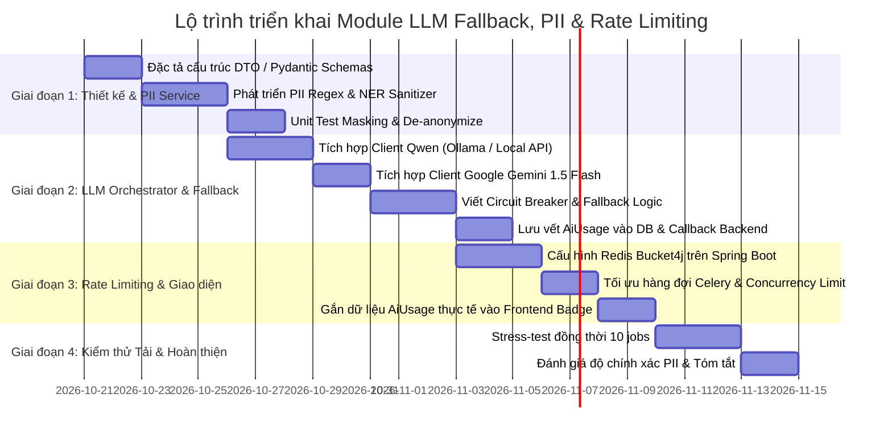

# Kế hoạch Vận hành Local LLM / Gemini Fallback, Bảo vệ PII và Giới hạn Request

> **Phiên bản:** 1.0.0  
> **Dự án:** SmartRec - AI-Powered Meeting Minutes & Smart Processing  
> **Trạng thái:** Kế hoạch kiến trúc & Đề xuất kỹ thuật (RFC / Architecture Plan)

---

## 1. Bối cảnh & Mục tiêu

Hệ thống **SmartRec** hiện đã hoàn thiện pipeline âm thanh (FFMPEG ➔ WebRTC ANS/AEC ➔ Pyannote Diarization ➔ Speaker Segments) và hỗ trợ Cloud GPU Server qua Google Colab. Bước tiếp theo là hoàn thiện tầng xử lý **NLP/LLM** (Tạo biên bản tóm tắt cuộc họp - Meeting Summary, phân loại công việc cần làm - Action Items, và hỏi đáp tương tác - Q&A).

Kế hoạch này giải quyết 3 yêu cầu trọng yếu:
1. **Local LLM & Gemini Fallback:** Ưu tiên vận hành mô hình Local (Qwen 2.5) để bảo mật nội bộ và tiết kiệm chi phí; tự động chuyển đổi dự phòng (Fallback) sang Google Gemini 1.5 Flash khi quá tải, gặp sự cố hoặc vượt giới hạn ngữ cảnh (Context Window).
2. **Bảo vệ PII (Personally Identifiable Information):** Cơ chế nhận diện, che giấu (Masking / Anonymization) thông tin nhạy cảm (SĐT, Email, CCCD, Thẻ ngân hàng, Tên riêng) trước khi gửi ra Cloud LLM bên ngoài và phục hồi (De-anonymization) lại kết quả sạch sẽ cho người dùng.
3. **Giới hạn Request (Rate Limiting & Concurrency Control):** Bảo vệ hạ tầng GPU Local khỏi tình trạng tràn VRAM (OOM), kiểm soát hạn mức gọi Google Gemini API (RPM/TPM) và quản lý quota theo từng người dùng/workspace.

---

## 2. Kiến trúc Tổng thể (High-Level Architecture)

```mermaid
flowchart TD
    subgraph Client_and_Backend ["Tầng Client & Backend"]
        UI["Web Frontend (React)"] -->|Yêu cầu tóm tắt/Q&A| GW["Spring Boot API Gateway"]
        GW -->|1. Rate Limiter (Bucket4j/Redis)| RLCheck{"Trong hạn mức?"}
        RLCheck -- No --> R429["HTTP 429 Too Many Requests"]
        RLCheck -- Yes --> Queue["Redis Message Queue"]
    end

    subgraph AI_Engine ["AI Engine Worker (Python)"]
        Queue --> Worker["Celery Worker (NLP Task)"]
        Worker --> PII_Pre["PII Protection Service\n(Detect & Anonymize)"]
        
        PII_Pre --> SessionStore[("Session Mapping Cache\nRedis/Memory")]
        PII_Pre --> SanitizedPrompt["Sanitized Prompt\n(Masked PII)"]

        SanitizedPrompt --> Router["LLM Orchestrator & Circuit Breaker"]

        Router -->|Ưu tiên 1 (Local)| LocalLLM["Local LLM (Qwen 2.5 7B/14B)\nvia Ollama / vLLM / Colab GPU"]
        
        LocalLLM -->|Lỗi / Timeout / VRAM OOM / Context > 32k| FallbackTrigger{"Kích hoạt\nFallback?"}
        FallbackTrigger -- Yes --> GeminiAPI["Google Gemini 1.5 Flash\n(Google GenAI API)"]
        FallbackTrigger -- No --> LocalSuccess["Local Output"]

        GeminiAPI --> GeminiSuccess["Gemini Output"]
        
        LocalSuccess --> PostMerge["PII De-anonymizer\n(Khôi phục tên & gán Task)"]
        GeminiSuccess --> PostMerge
        SessionStore -.-> PostMerge

        PostMerge --> UsageTracker["Usage & Cost Tracker\n(Ghi nhận AiUsage entity)"]
    end

    UsageTracker -->|Callback HTTP| GW
    GW -->|Lưu DB & Cập nhật UI| UI
```

---

## 3. Chi tiết 3 Trụ cột Kế hoạch

---

### Trụ cột 1: Vận hành Local LLM & Gemini Fallback Strategy

#### 1.1. Lựa chọn Mô hình
| Tiêu chí | Mô hình Chính (Primary): Local LLM | Mô hình Dự phòng (Fallback): Cloud LLM |
| :--- | :--- | :--- |
| **Tên mô hình** | **Qwen 2.5 (7B-Instruct / 14B-Instruct-GGUF)** | **Google Gemini 1.5 Flash** |
| **Môi trường chạy** | On-premise Docker / Ollama / Colab Tesla T4 | Google Cloud GenAI API |
| **Context Window** | 32,768 tokens (~30-40 phút audio) | 1,048,576 tokens (~3-4 giờ audio họp) |
| **Chi phí** | 0 VNĐ tiền token API (tận dụng phần cứng sẵn có) | ~$0.075 / 1M prompt tokens (rất rẻ) |
| **Tính riêng tư** | 100% Private, không gửi dữ liệu ra ngoài | Dữ liệu được bảo vệ qua tầng PII Sanitizer trước khi gửi |
| **Tốc độ xử lý** | 25 - 45 tokens/giây trên Tesla T4 GPU | 120 - 180 tokens/giây |

#### 1.2. Bộ kích hoạt chuyển đổi (Fallback Triggers & Circuit Breaker)
Hệ thống sử dụng mô hình **Circuit Breaker** (tương thích Resilience4j hoặc Python `tenacity`/`pybreaker`):

1. **Context Window Overflow:** Nếu transcript cuộc họp sau khi chuẩn hóa vượt quá **24,000 tokens**, hệ thống sẽ **bỏ qua Local LLM và gọi thẳng Gemini 1.5 Flash** để tránh hiện tượng cắt xén ngữ cảnh (truncation) hoặc tràn VRAM.
2. **GPU Healthcheck / Connection Timeout:** Nếu endpoint Local LLM (Ollama/vLLM) không phản hồi trong **45 giây** hoặc trả về lỗi kết nối (`ConnectionRefused`, HTTP 500/503), tự động switch sang Gemini.
3. **GPU Out Of Memory (OOM):** Khi phát hiện lỗi CUDA OOM hoặc VRAM đo được từ `ResourceTracker` đạt ngưỡng > 92%, job hiện tại lập tức fallback sang Gemini để không làm crash container.
4. **JSON Schema Parsing Error:** Nếu Local LLM sinh ra output không đúng schema JSON yêu cầu (`summary` gồm các headings, `task` gồm action items) sau 1 lần retry với prompt sửa lỗi, chuyển sang Gemini để đảm bảo tính sẵn sàng cho người dùng.

#### 1.3. Ghi nhận và Minh bạch Chi phí (`AiUsage`)
Đồng bộ với bảng dữ liệu `ai_usage` sẵn có trong PostgreSQL:
* `model_name`: `"Qwen 2.5 7B-Instruct"` hoặc `"Gemini 1.5 Flash"`
* `model_version`: `"2.5.0"` hoặc `"1.5-flash-002"`
* `fallback_used`: `true` nếu có fallback xảy ra, ngược lại `false`
* `input_tokens`, `output_tokens`, `total_tokens`: Đo lường chính xác từ Tokenizer (Qwen HuggingFace tokenizer hoặc Gemini API response metadata)
* `processing_time`: Thời gian xử lý từ lúc bắt đầu prompt đến khi trả kết quả
* `estimated_cost`: Tính toán chi phí USD theo đơn giá Gemini (nếu dùng fallback) hoặc 0.0 USD (nếu dùng Local)
* **Hiển thị trực quan:** Dữ liệu này được đẩy trực tiếp lên component `AiUsageBadge.jsx` trên giao diện, hiển thị chấm xanh (Local) hoặc chấm xanh dương (Cloud API).

---

### Trụ cột 2: Bảo vệ PII (Personally Identifiable Information Protection)

#### 2.1. Phân loại và Nhận diện PII
Tập trung vào dữ liệu định danh phổ biến trong các cuộc họp doanh nghiệp tại Việt Nam:

| Loại PII | Mẫu nhận diện (Regex / Pattern / NER) | Ví dụ dữ liệu thực | Mã thế chỗ (Token Mask) |
| :--- | :--- | :--- | :--- |
| **Số điện thoại** | `(?:\+84\|0)(?:3[2-9]\|5[6\|8\|9]\|7[0\|6-9]\|8[1-5]\|9[0-9])[0-9]{7}` | `0912345678`, `+84988776655` | `[PHONE_1]`, `[PHONE_2]` |
| **Email** | `[a-zA-Z0-9_.+-]+@[a-zA-Z0-9-]+\.[a-zA-Z0-9-.]+` | `nguyen.van.a@fpt.com` | `[EMAIL_1]` |
| **Số CCCD / CMND** | `\b[0-9]{9}\b` hoặc `\b[0-9]{12}\b` | `001201009999` | `[ID_CARD_1]` |
| **Tài khoản / Thẻ NH** | Chuỗi số từ 10 - 19 chữ số hoặc khớp thuật toán Luhn | `9704220011223344` | `[BANK_ACC_1]` |
| **Tên người (Person)** | Nhận diện kết hợp Speaker Label (`SPEAKER_00`), Named Entity Recognition (NER tiếng Việt với Underthesea / SpaCy) | `"Anh Hoàng"`, `"Chị Mai"` | `[PERSON_1]`, `[PERSON_2]` |
| **Thông tin mật** | Pattern API Keys, Mật khẩu, Token (`Bearer ...`, `token=...`) | `sk-ant-...`, `pass1234` | `[SECRET_REDACTED]` |

#### 2.2. Quy trình 2 chiều: Anonymization ➔ Inference ➔ Re-hydration

```
[Transcript Gốc]:
"Anh Hoàng (0912345678, hoang@smartrec.vn) phụ trách deploy bản vá trước thứ Sáu."
                               │
            [BƯỚC 1: PII Masking & Cache Mapping]
            Mapping = {
               "[PERSON_1]": "Anh Hoàng",
               "[PHONE_1]": "0912345678",
               "[EMAIL_1]": "hoang@smartrec.vn"
            }
                               │
                               ▼
[Prompt an toàn gửi tới LLM]:
"[PERSON_1] ([PHONE_1], [EMAIL_1]) phụ trách deploy bản vá trước thứ Sáu."
                               │
            [BƯỚC 2: LLM sinh Action Items]
            Output JSON: {
               "task": "Deploy bản vá hệ thống",
               "assignee": "[PERSON_1]",
               "deadline": "Thứ Sáu"
            }
                               │
                               ▼
            [BƯỚC 3: Re-hydration / De-anonymize]
            Thay thế [PERSON_1] ➔ "Anh Hoàng"
            (SĐT & Email nếu hiển thị công khai sẽ được che dạng: 0912***678)
```

#### 2.3. Quy định An toàn Ghi Log (Logging Sanitizer)
* Thiết lập một custom logging filter trong Python (`ai-engine`) và Logback (`Spring Boot`).
* Tự động lọc tất cả các chuỗi có định dạng Token JWT, mật khẩu, và mẫu PII trước khi ghi ra file log hoặc console.

---

### Trụ cột 3: Giới hạn Request (Rate Limiting & Concurrency Control)

#### 3.1. Phân tầng Kiểm soát Tải (Multi-Tier Throttling)

| Tầng kiểm soát | Cơ chế kỹ thuật | Ngưỡng cấu hình đề xuất | Mục tiêu bảo vệ |
| :--- | :--- | :--- | :--- |
| **1. User / Workspace Quota** (Spring Boot) | Redis Sliding Window / Bucket4j Rate Limiter | **Gói Free:** 5 req/phút, tối đa 20 jobs/ngày.<br>**Gói Pro:** 30 req/phút, 200 jobs/ngày. | Chống spam API, kiểm soát chi phí người dùng |
| **2. Local GPU Concurrency** (Celery Worker) | Tách hàng đợi Celery: `audio_queue` và `nlp_queue`, `--concurrency=1` | **Tối đa 1 job LLM chạy tại 1 thời điểm** trên cùng GPU | Chống tràn VRAM (OOM), tránh nghẽn GPU |
| **3. Burst Auto-Routing** (Dispatcher) | Kiểm tra độ dài hàng đợi Redis (`LLEN nlp_queue`) | Nếu hàng đợi đang có **> 3 jobs** chờ đợi: đề xuất hoặc tự động route thẳng sang Gemini | Giảm thời gian chờ đợi của người dùng từ 10 phút xuống < 30 giây |
| **4. Gemini API Quotas** (Outbound Throttler) | Token Bucket Throttler ở client gọi Gemini | Tối đa **12 RPM** (để giữ biên an toàn dưới trần 15 RPM của Google Free Tier) | Chống lỗi `HTTP 429 Resource Exhausted` từ Google |

#### 3.2. Cơ chế Retry & Backoff với Google Gemini API
* Sử dụng thuật toán **Exponential Backoff with Full Jitter**:
  $$\text{WaitTime} = \min(\text{MaxBackoff}, \text{BaseBackoff} \times 2^{\text{attempt}}) \pm \text{Jitter}$$
* Thời gian chờ: `1s` ➔ `2s` ➔ `4s` ➔ `8s` (tối đa 3 lần thử lại).
* Nếu vẫn thất bại do lỗi 429 quota từ Google: Chuyển task sang trạng thái tạm dừng ngắn (`RETRYING_DELAYED`) và thông báo ước tính thời gian chờ cho Client.

---

## 4. Kế hoạch Triển khai (Step-by-Step Implementation Roadmap)



### Chi tiết các tệp tin sẽ bổ sung / chỉnh sửa:

1. **Phía Python `ai-engine/`:**
   * `app/services/pii_sanitizer.py`: Service lọc và che thông tin nhạy cảm (regex + mapping store).
   * `app/services/llm_orchestrator.py`: Điều phối gọi Local Qwen ➔ Gemini fallback kèm Circuit Breaker.
   * `app/services/gemini_client.py`: Wrapper gọi Google GenAI SDK.
   * `app/services/local_llm_client.py`: Wrapper gọi Ollama/vLLM HTTP endpoint.
   * `app/pipelines/nlp_pipeline.py`: Hoàn thiện pipeline tóm tắt và sinh action items từ transcript.
2. **Phía Java `src/main/java/com/example/smartrec/`:**
   * `repository/AiUsageRepository.java` & `service/AiUsageService.java`: CRUD và thống kê lượng token/chi phí theo meeting/workspace.
   * `filter/RateLimitingFilter.java` (hoặc Bucket4j Redis Config): Kiểm soát giới hạn request gọi API tóm tắt.
   * `controller/AiUsageController.java`: Endpoint `GET /api/v1/meetings/{id}/ai-usage` cung cấp dữ liệu cho giao diện.
3. **Phía Frontend `Frontend/smartrec-frontend/`:**
   * `src/components/meeting/AiUsageBadge.jsx`: Thay thế mock data bằng dữ liệu thực tế từ API `GET /api/v1/meetings/{id}/ai-usage`.

---

## 5. Rủi ro Kỹ thuật & Phương án Giảm thiểu

| Rủi ro | Mức độ | Phương án Giảm thiểu |
| :--- | :---: | :--- |
| **Bỏ sót tên người phức tạp (Under-masking PII)** | Trung bình | Kết hợp danh sách người tham gia (Attendees) từ Speaker Diarization và Workspace Members làm từ điển bổ sung cho PII Sanitizer. |
| **Che nhầm từ ngữ thông thường (Over-masking)** | Thấp | Không áp dụng regex mù quáng; chỉ che số điện thoại khi đủ 10 số hợp lệ và có tiền tố nhà mạng VN; email theo chuẩn RFC. |
| **Local LLM phản hồi chậm làm nghẽn Worker** | Cao | Đặt cứng `timeout = 45s` cho Local LLM. Nếu quá 45s lập tức kích hoạt fallback sang Gemini và ghi log cảnh báo. |
| **Chạm trần Quota Google Gemini (429)** | Trung bình | Có Token Bucket giới hạn 12 RPM tại client; tự động fallback sang cơ chế xếp hàng chờ đợi (Queue Retry) kèm thông báo rõ ràng cho user. |

---

## 6. Kết luận & Đề xuất Bước tiếp theo

Kế hoạch này đảm bảo tính **bảo mật dữ liệu (PII)**, **tính sẵn sàng cao 99.9% (Fallback)** và **tối ưu hóa chi phí vận hành** cho SmartRec.

👉 **Đề xuất bước tiếp theo:** Sau khi anh/chị duyệt kế hoạch này, chúng ta sẽ bắt đầu bước đầu tiên: **Xây dựng module `pii_sanitizer.py` trong `ai-engine` và cấu hình biến môi trường Gemini API**.
