# SmartRec Database ERD

Nguồn: PostgreSQL `smartrec_db`, schema `public`, kiểm tra ngày 2026-11-20 (Asia/Bangkok). **DB hiện có 0 FOREIGN KEY.** Tất cả cạnh chấm trong sơ đồ là quan hệ logic suy ra từ cột UUID/JPA và mã sử dụng, không phải FK được PostgreSQL cưỡng chế. Cardinality là mô hình dự kiến dựa trên nullable/unique, không được DB bảo đảm. Bảng `ocrresult` được giữ như DB thực tế nhưng chưa có quan hệ được xác minh từ source.

```mermaid
erDiagram
    action_items {
        uuid id PK
        uuid assignee_user_id
        uuid meeting_id
        uuid processing_job_id
        uuid source_transcript_id
        uuid assignee_speaker_id
    }
    ai_usage {
        uuid id PK
        uuid job_id
        uuid meeting_id
    }
    context_payloads {
        uuid id PK
        uuid meeting_id
    }
    folders {
        uuid id PK
        uuid parent_id
        uuid user_id
    }
    job_dispatch_outbox {
        uuid id PK
        uuid job_id
    }
    job_stages {
        uuid id PK
        uuid job_id
    }
    media_file {
        uuid id PK
        uuid uploaded_by
    }
    meeting_slides {
        uuid slide_id PK
        uuid job_id
        uuid meeting_id
    }
    meeting_summaries {
        uuid id PK
        uuid meeting_id
        uuid processing_job_id
    }
    meetings {
        uuid id PK
        uuid active_job_id
        uuid media_file_id
        uuid folder_id
    }
    ocr_results {
        uuid keyframe_id PK
        uuid id PK
    }
    ocrresult {
        uuid keyframe_id PK
        uuid id PK
    }
    pending_media_uploads {
        uuid id PK
        uuid user_id
    }
    processing_jobs {
        uuid id PK
        uuid media_file_id
        uuid meeting_id
    }
    public_share_links {
        uuid id PK
        uuid created_by
        uuid meeting_id
    }
    refresh_tokens {
        uuid id PK
        uuid user_id
    }
    share_link_audits {
        uuid id PK
        uuid actor_id
        uuid share_link_id
    }
    slide_keyframes {
        uuid id PK
        uuid meeting_id
    }
    speaker_segments {
        uuid id PK
        uuid meeting_id
    }
    speakers {
        uuid id PK
        uuid meeting_id
    }
    transcripts {
        uuid id PK
        uuid meeting_id
        uuid processing_job_id
        uuid speaker_id
    }
    upload_sessions {
        uuid id PK
        uuid user_id
    }
    users {
        uuid id PK
        timestamp created_at
    }
    workspace_members {
        uuid id PK
        uuid user_id
    }
    users ||..o{ workspace_members : "user_id logical"
    users ||..o{ folders : "user_id logical"
    folders o|..o{ folders : "parent_id logical"
    folders o|..o{ meetings : "folder_id logical"
    users ||..o{ media_file : "uploaded_by logical"
    users ||..o{ pending_media_uploads : "user_id logical"
    users ||..o{ upload_sessions : "user_id logical"
    users ||..o{ refresh_tokens : "user_id logical"
    users ||..o{ public_share_links : "created_by logical"
    users ||..o{ share_link_audits : "actor_id logical"
    media_file ||..o| meetings : "media_file_id logical"
    media_file ||..o{ processing_jobs : "media_file_id logical"
    meetings o|..o{ processing_jobs : "meeting_id logical"
    processing_jobs o|..o{ meetings : "active_job_id logical"
    processing_jobs ||..o{ job_stages : "job_id logical"
    processing_jobs ||..o{ job_dispatch_outbox : "job_id logical"
    processing_jobs ||..o{ ai_usage : "job_id logical"
    meetings o|..o{ ai_usage : "meeting_id logical"
    meetings o|..o{ context_payloads : "meeting_id logical"
    meetings ||..o{ meeting_slides : "meeting_id logical"
    processing_jobs ||..o{ meeting_slides : "job_id logical"
    meetings ||..o{ meeting_summaries : "meeting_id logical"
    processing_jobs ||..o{ meeting_summaries : "processing_job_id logical"
    meetings ||..o{ action_items : "meeting_id logical"
    processing_jobs ||..o{ action_items : "processing_job_id logical"
    users o|..o{ action_items : "assignee_user_id logical"
    speakers o|..o{ action_items : "assignee_speaker_id logical"
    transcripts o|..o{ action_items : "source_transcript_id logical"
    meetings ||..o{ public_share_links : "meeting_id logical"
    public_share_links ||..o{ share_link_audits : "share_link_id logical"
    meetings ||..o{ slide_keyframes : "meeting_id logical"
    slide_keyframes ||..o{ ocr_results : "keyframe_id logical"
    meetings ||..o{ speakers : "meeting_id logical"
    meetings ||..o{ speaker_segments : "meeting_id logical"
    meetings ||..o{ transcripts : "meeting_id logical"
    processing_jobs ||..o{ transcripts : "processing_job_id logical"
    speakers o|..o{ transcripts : "speaker_id logical"
```

`workspace_id` ở các bảng liên quan không có bảng `workspaces` trong database này. Không có cạnh cho `ocrresult` vì không có mapping/source xác minh đích tham chiếu.
